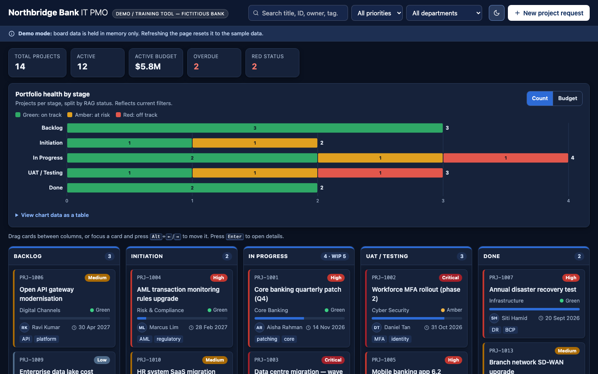

# Northbridge Bank IT PMO — Project Board (Demo)

A single-file IT project management Kanban board for tracking a bank IT portfolio from backlog to delivery.

> **Note:** Northbridge Bank is **fictitious**. This is a demo/training app.

    [](https://github.com/benchua75/kanban7/actions/workflows/ci-pages.yml) [](https://benchua75.github.io/kanban7/)

## Live demo

**<https://benchua75.github.io/kanban7/>**



## Features

- **Kanban stages:** Backlog → Initiation → In Progress → UAT / Testing → Done
- **WIP limit** on In Progress (5). The column is highlighted when it goes over.
- **Drag-and-drop** cards between columns and reorder them within a column
- **Keyboard moves:** focus a card, press <kbd>Alt</kbd>+<kbd>←</kbd>/<kbd>→</kbd> to move it, and press <kbd>Enter</kbd> to open its details
- **Filters** by priority and department, plus search by title, ID, owner or tag
- **RAG status** (Green / Amber / Red) and **priority** (Critical / High / Medium / Low) on every card
- **Detail dialog** for editing a project's stage, priority, RAG, department and progress. Moving a project to Done sets its progress to 100%.
- **New project request form** that emails the request through [FormSubmit](https://formsubmit.co/) and adds it to the Backlog
- **Portfolio summary:** total and active projects, active budget, overdue count and Red-status count
- **Portfolio health chart:** an inline-SVG stacked bar of projects per stage split by RAG, switchable between count and budget, with tooltips, keyboard focus and a data-table fallback. Click a bar to jump to that column.
- **Dark mode** by default, with a light theme toggle (in memory only)
- **Mobile layout:** swipeable scroll-snap columns, sticky stage tabs, ‹ › move buttons on touch screens and full-screen dialogs
- **Security hardening:** strict hashed Content-Security-Policy with Trusted Types, input sanitising and client-side form abuse controls. See [SECURITY.md](SECURITY.md).

## Tech stack

- One `index.html` file holding the markup, a `<style>` block and a `<script>`
- Vanilla HTML, CSS and JavaScript
- No frameworks, build step, CDN, web fonts or external assets. It uses the system font stack and inline SVG/Unicode icons.

## Installation

```bash
git clone https://github.com/benchua75/kanban7.git
cd kanban7
```

There's no `npm install` and no build step.

## How to run

- Double-click `index.html`, or open it from a terminal:
  - macOS: `open index.html`
  - Windows: `start index.html`
  - Linux: `xdg-open index.html`
- Or use the live demo at <https://benchua75.github.io/kanban7/>.

**Notes**

- **No persistence:** state lives only in memory, so a refresh resets the board to the seed data. This is by design.
- **Request form email:** set `FORMSUBMIT_EMAIL` in `index.html` to a real address, then confirm the activation email FormSubmit sends after the first submission. While it's the placeholder (`pmo-demo@example.com`), the form doesn't send anything. It offers "Add to board without sending" instead.

## Project structure

```
.
├── index.html                    # The whole app (markup + CSS + JS)
├── README.md
├── SECURITY.md                   # Threat model and residual risks
├── CLAUDE.md                     # Notes and constraints for AI-assisted development
├── scripts/csp-hash.py           # Refreshes/checks the CSP hashes of the inline script and style
├── docs/screenshot.png           # README screenshot (captured with the Playwright MCP server)
├── .mcp.json                     # Project-scoped MCP servers (Playwright)
├── .github/workflows/ci-pages.yml
└── .claude/commands/             # Claude Code slash commands
```

## CI/CD

[`.github/workflows/ci-pages.yml`](.github/workflows/ci-pages.yml) runs on every push and pull request:

1. **Check:** a gitleaks secret scan, the project constraint check (no storage APIs, external resources or HTML-string sinks), a CSP hash check (`scripts/csp-hash.py --check`) and an HTML sanity check.
2. **Deploy** (pushes to `main` only): publishes **only `index.html`** to GitHub Pages.

## Disclaimer

Northbridge Bank is a fictitious organisation created for demonstration and training. This project isn't affiliated with, endorsed by or connected to any real bank or financial institution. Any resemblance is coincidental.
